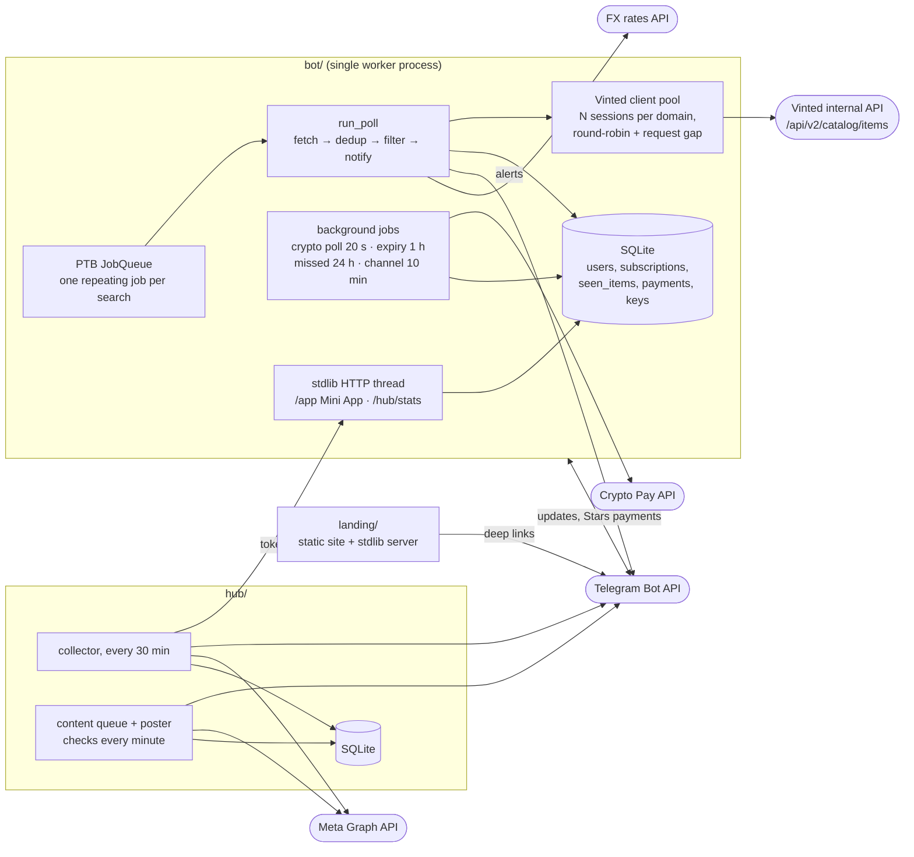

# Grailert

A multi-user Telegram bot that watches Vinted searches and alerts resellers the moment a matching listing goes live, with paid plans, a Telegram Mini App, a content hub and a static landing page.

## Features

- Watch any Vinted search (pasted URL or plain keyword) on 24 country domains, with include/exclude keyword and price filters.
- Alerts with photo gallery, price, total with fees, approximate USD conversion and a "cheaper than similar" badge based on the median of the current results.
- Per-user polling interval enforced by plan: Free (1 search, every 15 min), Basic (3 searches, every 2 min), Pro (unlimited, every 30 s).
- Payments in Telegram Stars and crypto (Crypto Pay API), trials, expiry reminders, referral bonus on the friend's first payment.
- Invite-only mode with one-time keys, waitlist and brute-force / key-sharing protection.
- 7 interface languages (en, fr, de, es, it, pl, ru) in the bot, the Mini App and the landing page.
- Telegram Mini App: searches, live feed and checkout on one screen, authenticated by Telegram `initData` HMAC.
- Daily auto-post of a live find to a Telegram channel.
- Hub: password-protected dashboard that collects bot/channel/Instagram metrics every 30 minutes and runs a scheduled content queue with autoposting.

## Architecture



How it works:

- **Polling.** Every active search is a separate repeating job in the PTB JobQueue; its interval is the user's chosen value clamped to the plan minimum (`plans.allowed_interval`). Vinted has no public API, so `vinted.py` seeds a cookie session from the domain homepage and calls the internal catalog endpoint, re-seeding on 401/403 and backing off on 429.
- **Rate limiting.** Each domain gets a pool of `VINTED_POOL` independent sessions handed out round-robin; each session serializes its requests behind a lock and keeps a minimum gap (`REQUEST_GAP`) between calls, so the queue per domain grows with the pool size, not with the user count. An optional proxy can be set for datacenter IPs.
- **Deduplication.** Item ids are stored per search in `seen_items`. The first poll only records a baseline (no alerts), later polls alert only on unseen ids, and ids are marked seen before keyword filtering so a filtered item never resurfaces.
- **Delivery.** New items are sent oldest-first, capped at `MAX_NOTIFY_PER_POLL` per poll with a summary message for the overflow; a user who blocked the bot gets their search paused instead of retried.
- **Plans and payments.** Stars invoices are confirmed via Telegram's pre-checkout/successful-payment updates; crypto invoices are polled every 20 s because the bot runs without a webhook, and underpayments are rejected. An hourly job sends expiry reminders and downgrades expired users to Free, pausing searches over the Free limit.
- **Hub.** A separate stdlib service pulls `/hub/stats` from the bot with a shared token, channel subscriber counts from the Bot API and Instagram/Facebook metrics from the Graph API; unconfigured sources are skipped. Content cards with a date are claimed atomically and published by the poster thread.

## Numbers

Counted from this repository:

- 3 deployable services (bot, hub, landing), all Python stdlib HTTP servers apart from `python-telegram-bot` and `httpx` in the bot.
- 9 SQLite tables in the bot, 6 in the hub.
- 7 languages, 3 plans, 3 purchasable products (month Basic, month Pro, year Pro).
- 7 test scripts with about 600 assertions (492 in the bot, 116 in the hub); network checks are opt-in.
- About 15k lines of Python, JavaScript, HTML and CSS.

## Tech stack

Python 3.11+, python-telegram-bot 21 (JobQueue), httpx (async, SOCKS proxy support), SQLite (WAL), stdlib `http.server` for the Mini App, hub and landing, vanilla JavaScript and CSS for all front-ends, Docker for deployment.

## Project structure

```
bot/        Telegram bot worker
  bot.py        handlers, JobQueue jobs, polling and notification loop
  vinted.py     Vinted session pool, URL parsing, filters, alert formatting
  db.py         SQLite schema and queries (users, searches, seen items, keys, payments)
  plans.py      plans, limits and prices
  billing.py    Crypto Pay invoices and payment checks
  rates.py      cached FX conversion to USD
  webapp.py     Mini App backend (/app) and stats endpoint for the hub (/hub/stats)
  app.html      Mini App front-end
  i18n.py, app_i18n.py   bot and Mini App strings, 7 languages
  ui.py         keyboards
  config.py     environment-driven settings
  test_*.py     5 self-contained test scripts
hub/        content dashboard and autoposter
  server.py     collector, JSON API, auth, uploads
  poster.py     scheduled publishing to Telegram / Instagram
  static/       dashboard UI
  test_*.py     2 test scripts
landing/    marketing site
  site/         static pages, 7-language i18n, assets
  build_pages.py, stamp_assets.py, set_domain.py   page generation, cache-busting, domain switch
  server.py     static server with clean URLs and security headers
```

## Getting started

The bot needs a Telegram bot token to start; polling needs outbound access to Vinted (which may block datacenter IPs, see `VINTED_PROXY`). Crypto payments need a Crypto Pay token; the hub's social metrics need Meta Graph API credentials. Without them the corresponding features are simply disabled.

Bot:

```bash
cd bot
python3 -m venv .venv && . .venv/bin/activate
pip install -r requirements.txt
cp .env.example .env        # set BOT_TOKEN, BOT_USERNAME, ADMIN_IDS
python bot.py
```

Hub:

```bash
cd hub
cp .env.example .env        # set HUB_PASSWORD at least
export $(grep -v '^#' .env | xargs) && python server.py
```

Landing:

```bash
cd landing
python3 set_domain.py https://your-domain.tld   # replaces the grailert.example placeholder
python3 server.py                                # serves site/ on $PORT (3000)
```

The landing links point to placeholder `https://telegram.example/...` addresses; replace them with your bot and channel links before publishing.

Tests (each script is standalone and exits non-zero on failure):

```bash
cd bot && for t in test_*.py; do python "$t"; done
LIVE_TESTS=1 python test_all.py   # also hit live Vinted and the FX API
cd ../hub && python test_hub.py && python test_poster.py
```

## License

MIT, see [LICENSE](LICENSE).
